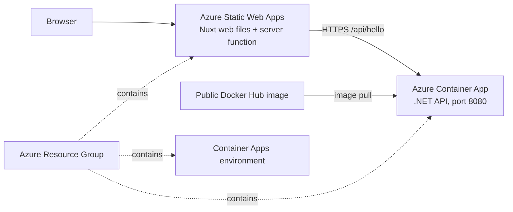

# Azure infrastructure

This Pulumi project implements the resources requested by GitHub issue #4:

- an Azure Resource Group;
- an Azure Static Web App for the Nuxt frontend;
- an Azure Container Apps environment for the .NET API;
- an Azure Container App for the .NET API.

These are the four Azure resources managed by this project. The backend image is
pulled from a public Docker Hub repository, so no registry credential or extra
identity resource is needed. No Azure resources are created by building this
project. `pulumi up` creates or changes Azure resources and must only be run
after the team approves the region and spending limit.

## Architecture



The Docker Hub repository must be public for Azure to pull the image without
credentials. The frontend's Nuxt server route reads the API base URL from
`NUXT_BACKEND_API_BASE` at runtime.

Static Web Apps distributes the web files globally. Its `Location` selects the
region for the managed Functions API, so confirm that the proposed region is
available for Static Web Apps before using the default shared location.

## Requirements and configuration

Install .NET SDK 10, Pulumi CLI, Azure CLI, Docker Desktop, and Node.js. Sign in
to the approved Azure subscription with `az login`, then select it with:

```powershell
az account set --subscription "<subscription name or ID>"
```

From the `infrastructure` directory, create or select a Pulumi stack and set
the project-specific values:

```powershell
pulumi stack init dev
# If the stack already exists, use: pulumi stack select dev
pulumi config set location francecentral
pulumi config set projectPrefix agentic-orchestrator-dev
pulumi config set frontendName "agentic-orchestrator-dev-<unique-suffix>"
```

`francecentral` is the proposed region for both the backend and Static Web Apps;
confirm that it is available for both before deployment. The project prefix
should be lowercase and short enough for Azure resource names. The Resource
Group name is derived from the prefix (`<projectPrefix>-rg`), and the Static Web
App name must be globally unique. The Static Web App uses the Free SKU.

## Backend image on Docker Hub

Create a Docker Hub repository and make its visibility public. From the
`backend` directory, build and publish the Linux image:

```powershell
$dockerHubUser = "<docker-hub-username>"
$image = "docker.io/$dockerHubUser/agentic-orchestrator-api:dev"
docker build --platform linux/amd64 -f src/Api/Dockerfile -t $image .
docker login --username $dockerHubUser
docker push $image
```

Configure Pulumi with the full public image name:

```powershell
pulumi config set backendImage $image
```

Docker Hub applies pull limits, so this is best suited to a demo or low-volume
deployment. Anyone can download a public image; do not include secrets in the
image.

## Preview and deployment

Review the planned resources first:

```powershell
pulumi preview
```

Run `pulumi preview` before deployment. With the public image published and
`backendImage` configured, the preview should show the four resources listed
above. Only run `pulumi up` after the team explicitly approves the region and
cost estimate. These Azure resources may incur charges; Container Apps usage
can be billed, and the Visual Studio subscription's current `$0.00` cost is not
a monthly spending limit.

To remove resources, review `pulumi destroy` with the team first. Do not use it
if the stack contains resources that should be retained.

## Frontend deployment

The frontend uses a Nuxt server route (`frontend/server/api/hello.get.ts`) to
call the .NET API, so a static-only export is not sufficient. Nitro's `azure_swa`
preset generates `.output/public` and an Azure Functions server under
`.output/server/functions`. The frontend config now sets this preset, includes
`@azure/functions` v4, and generates `staticwebapp.config.json` with the
supported Node 22 Functions runtime. The server route is included in the build.

Once the Static Web App and API exist, configure
`NUXT_BACKEND_API_BASE` in the Static Web App's application settings to the
`backendUrl` Pulumi output, then connect the repository using the Static Web Apps
deployment setup. Nitro's workflow build locations are:

| Setting | Value |
|---|---|
| App location | `/` |
| API location | `.output/server` |
| Output location | `.output/public` |

Microsoft's Azure walkthrough currently describes Nuxt 3; Nitro's current
provider documentation describes the `azure_swa` preset. This repository's Nuxt
4 build has confirmed that the server route is emitted as an Azure Function. A
remote Static Web Apps deployment still needs to be performed and checked. No
GitHub Actions workflow exists on this branch; issue #4 asks for infrastructure
resources, so deployment automation remains separate work.

## Verification status

- `dotnet restore .\infrastructure\agentic-orchestrator-iac.csproj --source
  C:\Users\MSI\.nuget\packages --ignore-failed-sources` succeeded using cached
  packages. The private Azure DevOps NuGet source returned HTTP 401 and direct
  nuget.org access failed certificate validation.
- `dotnet build .\infrastructure\agentic-orchestrator-iac.csproj --no-restore`
  succeeded with zero warnings and zero errors.
- `npm.cmd run build` succeeded and Nitro emitted the `azure-swa` server
  function, including `routes/api/hello.get.mjs`. Local Node.js 22.20.0 is below
  Nuxt's supported range and produced a warning; upgrade Node before relying on
  local or CI builds.
- npm reported 15 dependency vulnerabilities (3 low, 11 moderate, 1 high). They
  were not automatically changed; review `npm audit` separately.
- Docker image build and push to the public Docker Hub repository have not been
  performed. Docker Engine was unavailable in the local environment, and no
  public image exists yet.
- `pulumi preview` and Azure deployment have not been performed. Team approval
  for France Central and a spending limit, Azure sign-in, and a published public
  image are still required. No Azure resources have been
  created.
