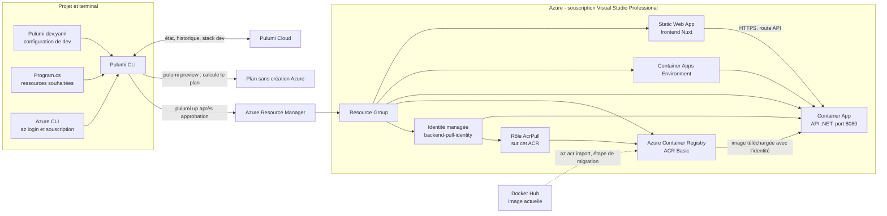
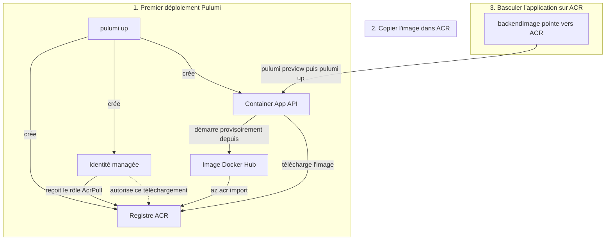

# Infrastructure Azure

Ce dossier décrit l'infrastructure Azure du projet avec Pulumi et C#. Pulumi
lit le programme et la configuration de la stack, prépare un plan avec
`pulumi preview`, puis applique ce plan à Azure avec `pulumi up`.

## Vue d'ensemble



Pulumi Cloud garde l'état de la stack `dev` et l'historique des opérations. Le
CLI utilise la connexion Azure de l'utilisateur courant pour appeler Azure.
L'ID de souscription est aussi fixé dans la configuration Pulumi afin que la
stack cible Visual Studio Professional.

## Rôle des fichiers

| Fichier ou dossier | Rôle |
|---|---|
| `Pulumi.yaml` | Nom et description du projet Pulumi ; indique que le programme est en .NET. |
| `Pulumi.dev.yaml` | Valeurs utilisées par la stack `dev` : région, noms, image, registre et souscription. |
| `Program.cs` | Décrit les ressources Azure et leurs liens. |
| `agentic-orchestrator-iac.csproj` | Cible .NET 10 et référence Pulumi et son fournisseur Azure Native. |
| `bin/`, `obj/` | Fichiers générés par la compilation .NET. |
| `README.md` | Ce guide d'architecture et d'exploitation. |

`Pulumi.dev.yaml` ne contient actuellement pas de mot de passe ou de token.
`credentials.json` dans le profil Windows contient l'accès Pulumi local : ne le
copiez pas dans le dépôt et ne le partagez pas.

## Ressources décrites par `Program.cs`

Pulumi prévoit sept ressources Azure :

1. **Resource Group** `agentic-orchestrator-dev-rg` : regroupe les ressources.
2. **Static Web App** : ressource Azure pour le frontend Nuxt ; le niveau choisi
   est Free.
3. **Container Apps Environment** : environnement qui héberge l'API.
4. **Container App** : exécute l'image de l'API sur le port `8080`, avec ingress
   externe HTTPS, `0.5` CPU, `1Gi` de mémoire et une échelle de 0 à 1 réplique.
5. **ACR** : registre où sera copiée l'image du backend ; le code choisit le SKU
   Basic.
6. **Identité managée attribuée par l'utilisateur** : identité Azure attachée à
   la Container App pour l'accès au registre.
7. **Affectation du rôle `AcrPull`** : donne à cette identité le droit de lire
   les images dans cet ACR, sans lui donner le droit d'en publier.

Le total `8 to create` dans le dernier preview comprend ces sept ressources
Azure et l'enregistrement de la stack Pulumi elle-même.

## Configuration de la stack `dev`

Depuis ce dossier, `pulumi config` affiche les valeurs actuelles :

| Clé | Valeur actuelle | Utilisation |
|---|---|---|
| `location` | `francecentral` | Région du groupe de ressources et de toutes les ressources prévues, y compris la Static Web App. |
| `projectPrefix` | `agentic-orchestrator-dev` | Préfixe de nommage pour les ressources. |
| `frontendName` | `agentic-orchestrator-dev-ibtihelmanaa-7f3a91` | Nom globalement unique de la Static Web App. |
| `registryName` | `agenticorchestratoribtihelmanaa7f3a91` | Nom ACR ; Azure a confirmé qu'il est disponible. |
| `backendImage` | `docker.io/ibtihelmanaa/agentic-orchestrator-api:dev` | Image utilisée au premier déploiement. |
| `azure-native:subscriptionId` | `5e5527ec-a980-4611-895e-258a6bdf75e3` | Souscription Visual Studio Professional ciblée. |

### Décisions confirmées par le chef de projet

- `francecentral` convient pour le backend. Azure a refusé la création de la
  Static Web App dans cette région car elle n'est pas disponible pour
  `Microsoft.Web/staticSites`.
- Le plafond annoncé est de **50 €** pour l'unique environnement prévu. Le
  destinataire des alertes de dépenses reste à préciser.
- L'équipe peut créer son propre ACR ; le registre configuré ci-dessus est donc
  cohérent avec cette décision.
- La licence Visual Studio Professional ne donne pas automatiquement les droits
  Azure : la possibilité de créer les ressources dépend du rôle attribué au
  compte dans la souscription.
- Le chef de projet n'a pas précisé séparément la région des fonctions API de
  Static Web Apps. La configuration actuelle utilise `francecentral`, mais
  Azure a refusé cette région pour ce type de ressource.

`Pulumi.dev.yaml` contient les paramètres de la stack, pas le programme C#.
`pulumi config set` modifie ces paramètres. Le fichier doit être ajouté, commité
et poussé dans Git pour que les collègues récupèrent les mêmes valeurs.

## Image du backend : Docker Hub vers ACR

L'image a été construite et poussée vers Docker Hub. Un conteneur local utilisant
cette image a répondu `Hello from backend` sur `/api/hello`. La migration vers
ACR se fait en deux phases car ACR doit exister avant de recevoir l'image.
Pour la première phase, l'image Docker Hub doit être publique afin que la
Container App puisse la télécharger sans identifiants. Vérifiez sa visibilité
dans Docker Hub avant le premier déploiement.



Le premier déploiement démarre l'API depuis Docker Hub et crée ACR ainsi que
l'identité managée. La commande `az acr import`, lancée par une personne
autorisée sur Azure, copie ensuite l'image dans ACR. Enfin, le second
déploiement fait pointer la Container App vers ACR : son identité managée,
autorisée par le rôle `AcrPull`, lui permet alors de télécharger l'image.

### Phase 1 : créer les ressources Azure

Le premier déploiement garde `backendImage` sur Docker Hub. L'API peut donc
démarrer pendant que l'ACR est créé. Après approbation de la région et du budget
mis à jour, depuis `infrastructure` :

```powershell
az account show --output table
pulumi stack select dev
dotnet build .\agentic-orchestrator-iac.csproj --no-restore
pulumi preview
pulumi up
```

Avant de confirmer `pulumi up`, vérifiez le plan affiché et l'approbation de
l'équipe. Cette commande crée réellement les ressources et peut entraîner des
frais. `pulumi preview` ne crée rien.

### Phase 2 : copier l'image dans ACR

Après la création du registre, Azure peut importer directement l'image publique
depuis Docker Hub. Cela ne nécessite pas de `docker pull`, `docker tag` ou
`docker push` local. La commande requiert une connexion Azure et des droits
d'écriture/import sur le registre.

```powershell
$registryName = "agenticorchestratoribtihelmanaa7f3a91"
az acr import --name $registryName --source docker.io/ibtihelmanaa/agentic-orchestrator-api:dev --image agentic-orchestrator-api:dev
az acr repository list --name $registryName --output table
```

### Phase 3 : faire lire l'image depuis ACR

Dans `infrastructure`, changez la valeur de l'image puis examinez le plan :

```powershell
pulumi config set backendImage agenticorchestratoribtihelmanaa7f3a91.azurecr.io/agentic-orchestrator-api:dev
pulumi preview
```

Après approbation et vérification du plan, appliquez la mise à jour :

```powershell
pulumi up
```

La Container App possède une identité managée. Grâce au rôle `AcrPull`, Azure
Container Apps peut télécharger l'image depuis ACR sans mot de passe ACR dans le
code. L'identité de l'application ne publie pas d'image ; l'import est effectué
par le compte humain Azure.

## Frontend

Pulumi crée la ressource Static Web App, mais ne publie pas encore les fichiers
Nuxt. Le frontend utilise Nitro avec le preset `azure_swa`; sa route serveur
`frontend/server/api/hello.get.ts` appelle le backend. Après création et
déploiement du site, configurez `NUXT_BACKEND_API_BASE` dans les paramètres de
l'application avec la sortie `backendUrl` de Pulumi.

Les emplacements de build attendus par le workflow Static Web Apps sont :

| Paramètre | Valeur |
|---|---|
| App location | `/` |
| API location | `.output/server` |
| Output location | `.output/public` |

Aucun workflow GitHub Actions de déploiement du frontend n'est présent dans
cette branche ; cette automatisation reste une étape séparée.

## État actuel et vérifications

- `dotnet build .\agentic-orchestrator-iac.csproj --no-restore` réussit avec
  deux avertissements `NU1902` sur des dépendances OpenTelemetry et zéro erreur.
- Le premier `pulumi up` a échoué sur la région de la Static Web App. Il a
  néanmoins créé le groupe de ressources, l'environnement Container Apps,
  l'identité managée et l'ACR. La Static Web App a échoué ; l'affectation
  `AcrPull` et la Container App backend ne figurent pas comme créées.
- L'image Docker Hub et le backend local ont été testés. L'image n'a pas encore
  été importée dans ACR.
- Le plafond annoncé par le chef de projet est de 50 €, mais aucun budget Azure
  ni destinataire d'alerte n'est configuré. Vérifiez les coûts des ressources
  déjà créées et le rôle Azure du compte avant de relancer `pulumi up`.
- La Static Web App n'a pas encore reçu les fichiers frontend.

Pour supprimer des ressources, `pulumi destroy` est une opération destructive :
vérifiez d'abord son plan et les ressources concernées avec l'équipe.
